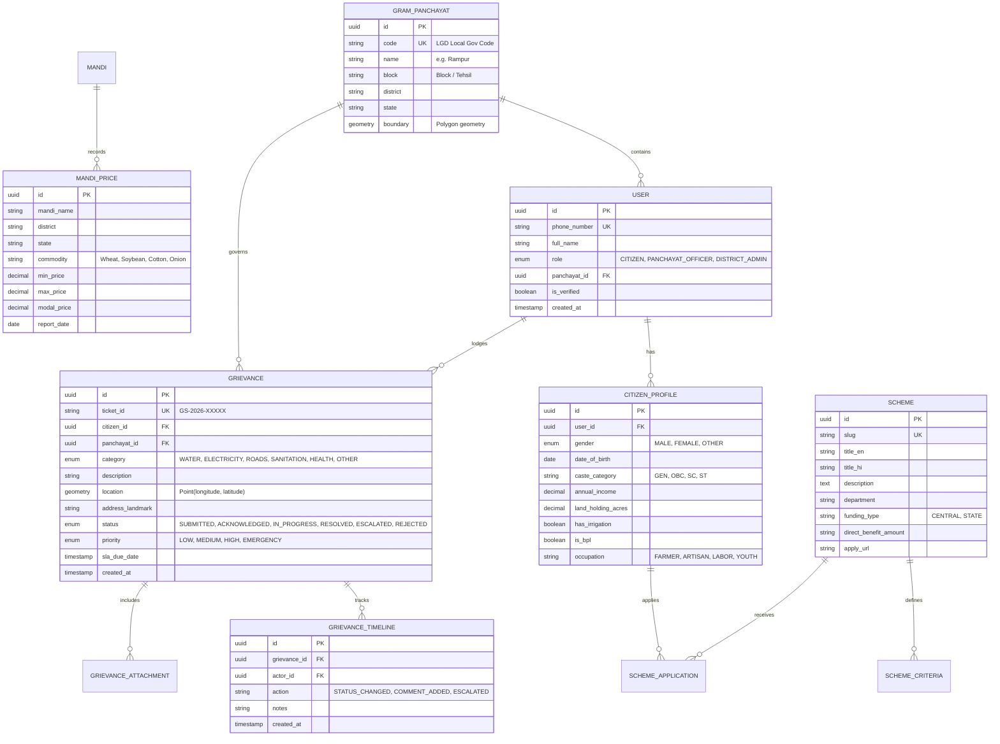

# 🏗️ GramSathi System Architecture Specification

**Document Version:** 1.0.0  
**Target Environment:** Cloud-native (Containerized / Kubernetes / AWS / GCP / DigitalOcean) + Edge PWA  
**System Classification:** High-Availability, Low-Bandwidth Optimized, Offline-Resilient Civic & Agri Platform  

---

## 1. Architectural Drivers & Non-Functional Requirements (NFRs)

Rural digital infrastructure imposes specific constraints that standard urban web applications do not address:

| Constraint / NFR | Target Metric | Architectural Solution |
| :--- | :--- | :--- |
| **Network Quality** | High packet drop, intermittent 2G/3G (50-250 kbps) | Aggressive PWA asset pre-caching, Gzip/Brotli compression, sub-80KB initial JS chunk, WebP/AVIF images. |
| **Device Capabilities** | Low-cost Android devices ($60-$120), 2GB RAM | Minimal DOM depth, virtualized lists for Mandi feeds, zero heavy client-side computation. |
| **Availability / Offline** | 100% grievance logging & profile editing available offline | IndexedDB local storage with persistent Outbox sync queue and background service workers. |
| **Language & Literacy** | Multi-dialect Indic languages, varying functional literacy | Iconographic navigation, dual-language bilingual rendering, Voice STT/TTS pipelines. |
| **Spatial Precision** | Exact location of civic breakdown (pothole, water leak, pole) | PostGIS spatial geometry (`ST_Point`), automated reverse geocoding with panchayat boundary bounding boxes. |
| **Data Privacy** | Indian Digital Personal Data Protection (DPDP) Act | Strict field-level tokenization for citizen identities, role-based access control, explicit consent storage. |

---

## 2. High-Level Architecture (C4 Model)

### 2.1 Context Diagram (Level 1)

```
                            ┌─────────────────────────────────┐
                            │    National Agriculture APIs    │
                            │   (Agmarknet / e-NAM / IMD)     │
                            └────────────────┬────────────────┘
                                             │ Mandi & Weather Data
                                             ▼
┌──────────────────┐               ┌──────────────────┐               ┌──────────────────┐
│  Rural Citizen   │ ◄───────────► │    GramSathi     │ ◄───────────► │ Gram Panchayat   │
│ (Farmer / Youth) │  Web App/PWA  │  Cloud Platform  │  Officer Web  │ Staff & Sarpanch │
└──────────────────┘               └─────────┬────────┘               └──────────────────┘
                                             │
                                             ├────────────────────────────────┐
                                             ▼                                ▼
                            ┌─────────────────────────────────┐ ┌─────────────────────────────────┐
                            │   Govt Scheme Repositories      │ │        AI / LLM Services        │
                            │   (MyScheme / DBT Bharat APIs)  │ │   (Google Gemini Multimodal)    │
                            └─────────────────────────────────┘ └─────────────────────────────────┘
```

---

### 2.2 Container Diagram (Level 2)

```
                                      [ HTTPS / WSS ]
                                             │
                                             ▼
                                  ┌─────────────────────┐
                                  │   Cloudflare CDN    │
                                  │   & Edge Caching    │
                                  └──────────┬──────────┘
                                             │
                                             ▼
                                  ┌─────────────────────┐
                                  │ NGINX / Cloud Gate  │
                                  │ Reverse Proxy & SSL │
                                  └──────────┬──────────┘
                                             │
                    ┌────────────────────────┴────────────────────────┐
                    ▼                                                 ▼
        ┌───────────────────────┐                         ┌───────────────────────┐
        │  Next.js 14 Frontend  │                         │ Fastify Core Backend  │
        │  PWA (Client App)     │                         │  API Gateway & REST   │
        │  - App Router (SSR)   │                         │  - Rate Limiting      │
        │  - Service Worker     │                         │  - Zod Validation     │
        │  - Dexie.js (Offline) │                         │  - Auth & RBAC        │
        └───────────────────────┘                         └───────────┬───────────┘
                                                                      │
        ┌─────────────────────────────────────────────────────────────┼──────────────────────────────┐
        ▼                                                             ▼                              ▼
┌───────────────┐                                             ┌───────────────┐              ┌───────────────┐
│  PostgreSQL   │                                             │  Redis Cache  │              │ BullMQ Worker │
│ 16 + PostGIS  │                                             │   & Pub/Sub   │              │ Async Queue   │
│ - Users       │                                             │ - Mandi TTL   │              │ - SMS / OTP   │
│ - Schemes     │                                             │ - Auth Token  │              │ - Auto-SLA    │
│ - Grievances  │                                             │ - Geohash idx │              │ - OCR & Image │
└───────────────┘                                             └───────────────┘              └───────┬───────┘
                                                                                                     │
                                                               ┌─────────────────────────────────────┴───────┐
                                                               ▼                                             ▼
                                                       ┌───────────────┐                             ┌───────────────┐
                                                       │ Google Gemini │                             │ Cloud Storage │
                                                       │ 1.5 Flash API │                             │  (S3 / MinIO) │
                                                       └───────────────┘                             └───────────────┘
```

---

## 3. Data Architecture & Entity Relationship Model

The schema uses PostgreSQL 16 with the **PostGIS** extension for geographic spatial bounds and distance calculations.



---

## 4. Offline-First Synchronization Protocol

```
┌────────────────────────────────────────────────────────────────────────┐
│                        Citizen Client (PWA)                            │
│                                                                        │
│  [User submits Grievance / Updates Profile]                            │
│                    │                                                   │
│                    ▼                                                   │
│          Is Browser Online? ───► YES ───► Standard Fastify API Call    │
│                    │                                                   │
│                   NO                                                   │
│                    │                                                   │
│                    ▼                                                   │
│       Save to Dexie (IndexedDB)                                        │
│       - table: `outbox_mutations`                                      │
│       - state: 'QUEUED'                                                │
│       - optimistic UI displays "Saved Locally"                         │
│                    │                                                   │
│                    ▼                                                   │
│       Background Service Worker registers 'sync' tag                   │
│                    │                                                   │
│       Network Restored Event                                           │
│                    │                                                   │
│                    ▼                                                   │
│       Process `outbox_mutations` FIFO                                  │
│       - POST /api/v1/sync/batch                                        │
│       - Resolves idempotency token (UUIDv4 generated at creation)      │
│       - Updates status to 'SYNCED' with server-allocated Ticket ID     │
└────────────────────────────────────────────────────────────────────────┘
```

### Conflict Resolution Strategy
1. **Grievance Creation**: Always append-only; UUID generated on client guarantees zero collision upon late ingestion.
2. **Citizen Profile Edits**: **Last-Write-Wins (LWW)** backed by an integer `version` increment column. If client version `<` server version, server returns HTTP 409 Conflict with the current canonical profile for client reconciliation.

---

## 5. AI Multimodal & Multilingual Pipeline

### 5.1 Multimodal Grievance Assessment
When a citizen snaps a photo of a civic issue (e.g., broken handpump, waterlogging):
1. **Client-side Compression**: Canvas downsamples the image to max 1280px width, WebP format (<250 KB).
2. **Gemini Vision Processing**:
   - Classifies category (`WATER_SUPPLY`, `ROAD_DAMAGE`, `ELECTRICAL_HAZARD`).
   - Assesses severity score (`1 - Cosmetic` to `5 - Emergency Hazard`).
   - Auto-extracts tags to reduce typing for the citizen.

### 5.2 Conversational Scheme Assistant
- Integrated via **Google Gemini 1.5 Flash**.
- Natural language query: *"Mere paas 2 acre zameen hai aur main chhota kisan hoon, mujhe konsi yojana mil sakti hai?"*
- System prompt injects:
  - Structured catalog of active central/state schemes.
  - Citizen's demographic context (if consented).
- Response generated in natural, conversational rural Hindi/Indic language with step-by-step guidance.

---

## 6. Security, RBAC & Governance Matrix

| Role | Permissions & Boundaries |
| :--- | :--- |
| **Citizen (`CITIZEN`)** | Can view public schemes, mandi rates; can create/view their own grievances & applications. Strict row-level isolation (`WHERE citizen_id = auth.uid()`). |
| **Gram Panchayat Officer (`PANCHAYAT_OFFICER`)** | Can view and update grievances whose `panchayat_id` matches their assigned village; cannot alter citizen personal identity records. |
| **Block Dev Officer (`BLOCK_ADMIN`)** | Can view aggregated analytics across all Panchayats in their block; receives automated escalation alerts for breached SLAs. |
| **Super Admin (`SYSTEM_ADMIN`)** | Manages scheme master records, mandi data synchronization, and system configuration. |

### DPDP Act & Data Privacy Rules:
- **Aadhaar Protection**: GramSathi *never* stores raw 12-digit Aadhaar numbers. If identity verification is enabled, only masked VID (Virtual ID) or SHA-256 salted hashes are processed.
- **Data Minimization**: Location access is requested strictly when capturing a grievance or locating the nearest Mandi.
- **Audit Logs**: All state transitions (`GRIEVANCE_TIMELINE`) maintain immutable creator ID, timestamp, and client IP hash.
