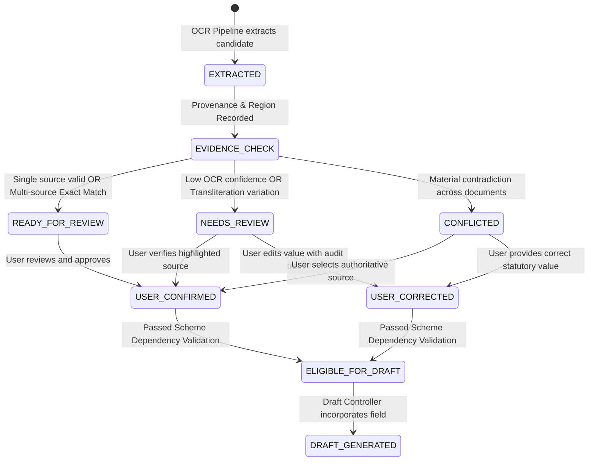
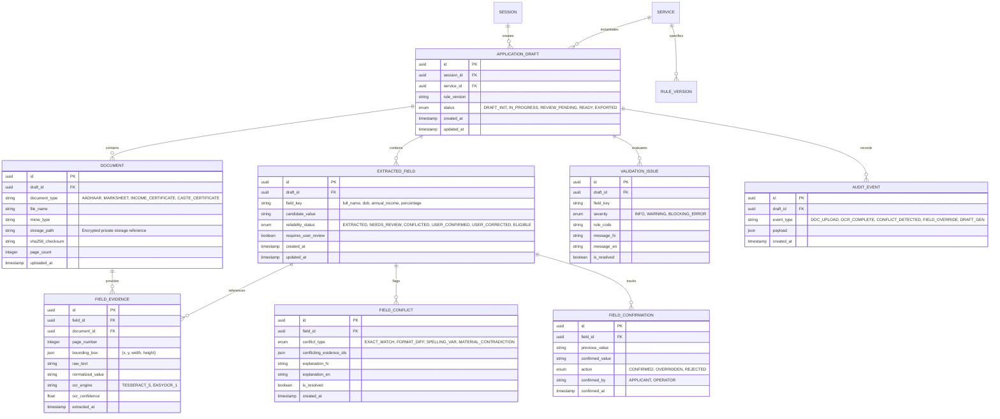

# 🏗️ GramSathi AI — System Architecture Specification

**Document Version:** 2.0.0  
**Project:** GramSathi AI (ग्राम साथी)  
**Core Technical Innovation:** Evidence-Linked, Confidence-Gated Application Generation  
**Classification:** Voice-First Government Application Preparation & Evidence Reconciliation Platform  

---

## 1. Architectural Vision & Core Innovation

GramSathi AI is an offline-resilient, voice-first assistant designed to help rural citizens prepare, verify, and complete complex government welfare and scholarship applications without administrative rejection.

Unlike traditional OCR or generic LLM-based form fillers that indiscriminately extract and overwrite text, GramSathi AI implements an **Evidence Intelligence Engine**:
- **Field Provenance**: Every extracted field retains an immutable, auditable link to its source document, page number, bounding box coordinates, and extraction engine metadata.
- **Cross-Document Reconciliation**: Multiple documents (e.g., Aadhaar, Marksheet, Income Certificate) claiming the same identity attribute are matched and compared deterministically.
- **Conflict & Uncertainty Classification**: Inconsistencies are classified (Exact Match, Formatting Difference, Spelling/Transliteration Variation, Material Contradiction, Missing/Unreadable).
- **Confidence-Gated Draft Generation**: A formal field reliability state machine ensures that unverified, low-confidence, or conflicted data can **never silently enter an official application draft**.

---

## 2. High-Level Architecture (C4 Model)

### 2.1 Context Diagram (Level 1)

```
                            ┌─────────────────────────────────┐
                            │      Official Govt Portals      │
                            │   (National Scholarship Portal, │
                            │     State Scholarship Portals)  │
                            └────────────────┬────────────────┘
                                             │ User-Controlled Hand-off
                                             ▼
┌──────────────────┐               ┌──────────────────┐               ┌──────────────────┐
│  Rural Citizen   │ ◄───────────► │   GramSathi AI   │ ◄───────────► │  Village Kiosk / │
│ (Student/Farmer) │  Voice & Text │  Cloud Platform  │  Review UI    │ CSC Operator /   │
│  (Mobile App)    │  (Hindi/Indic)│ (FastAPI Core)   │               │ Panchayat Sachiv │
└──────────────────┘               └─────────┬────────┘               └──────────────────┘
                                             │
                                             ├────────────────────────────────┐
                                             ▼                                ▼
                            ┌─────────────────────────────────┐ ┌─────────────────────────────────┐
                            │    Private Document Storage     │ │     Speech & OCR Adapters       │
                            │   (Encrypted Object Storage)    │ │   (Tesseract / EasyOCR / STT)   │
                            └─────────────────────────────────┘ └─────────────────────────────────┘
```

---

### 2.2 Container Diagram (Level 2)

```
                                  [ Flutter Mobile Application ]
                           (Hindi Voice, Text, Camera Upload, Review UI)
                                                 │
                                                 │ HTTPS / REST API
                                                 ▼
                             ┌───────────────────────────────────────┐
                             │        FastAPI Gateway & Core         │
                             │  - Sessions & Consent Management      │
                             │  - Workflow State Orchestrator        │
                             │  - Request Validation & Auth          │
                             └───────────────────┬───────────────────┘
                                                 │
         ┌───────────────────────────────────────┼───────────────────────────────────────┐
         ▼                                       ▼                                       ▼
┌─────────────────────────┐             ┌─────────────────────────┐             ┌─────────────────────────┐
│ Input Processing Layer  │             │ Core Innovation Layer   │             │ Application Intel Layer │
│                         │             │ (Evidence Intelligence) │             │                         │
│ - Speech STT Adapter    │ ──────────► │ 1. Provenance Manager   │ ──────────► │ - Scheme Config Rules   │
│ - Transcript Corrector  │             │ 2. Field Matcher        │             │ - Dependency Graph(DAG) │
│ - Document Sanitizer    │             │ 3. Conflict Detector    │             │ - Draft Controller      │
│ - OCR Engine Adapters   │             │ 4. User Override Manager│             │ - Portal Handoff Prep   │
└─────────────────────────┘             └─────────────────────────┘             └─────────────────────────┘
         │                                       │                                       │
         └───────────────────────────────────────┼───────────────────────────────────────┘
                                                 │
                                                 ▼
                             ┌───────────────────────────────────────┐
                             │         Shared Infrastructure         │
                             │ - PostgreSQL Relational DB            │
                             │ - Private Encrypted Document Storage  │
                             │ - Immutable Audit Trail & Logs        │
                             │ - Rule Engine Versioning Store        │
                             └───────────────────────────────────────┘
```

---

## 3. The Evidence Intelligence Engine (Deep Technical Design)

### 3.1 Field Decoupling: Fields vs. Evidence
Traditional database schemas store fields as scalar strings (e.g., `full_name: "Yash Sharma"`). When a second document is uploaded, the existing value is either overwritten or silently dropped.

In GramSathi AI, **`ExtractedFields` and `FieldEvidence` are decoupled**:
- An **`ExtractedField`** represents the canonical application attribute required by the target government scheme.
- A **`FieldEvidence`** record represents an immutable, atomic observation extracted from a specific document.

```
Application Field: [ full_name ]
  ├── Evidence #1: { Doc: "Aadhaar.pdf", Page: 1, Value: "Yash Sharma", Region: [x,y,w,h], Conf: 0.98 }
  ├── Evidence #2: { Doc: "Marksheet.jpg", Page: 1, Value: "Yash S Sharma", Region: [x,y,w,h], Conf: 0.92 }
  └── Evidence #3: { Doc: "Income_Cert.pdf", Page: 1, Value: "Yash Sharma", Region: [x,y,w,h], Conf: 0.89 }
```

### 3.2 Conflict Classification Taxonomy
The Cross-Document Reconciliation Engine classifies multi-source evidence comparisons into five deterministic severity categories:

1. **EXACT_MATCH**: Normalized string equality across all evidence sources (`normalize(A) == normalize(B)`).
2. **FORMAT_VARIATION**: Harmless differences in punctuation, whitespace, or date formatting (e.g., `12-04-2005` vs `12/04/2005`).
3. **SPELLING_OR_TRANSLITERATION_VARIATION**: Levenshtein edit distance $\le 2$ or common Indic phonetic transliteration variations (e.g., `Yash Sharma` vs `Yash S Sharma` or `Vikas` vs `Bikash`). Requires human review confirmation.
4. **MATERIAL_CONTRADICTION**: Distinct semantic values (e.g., differing Dates of Birth, conflicting annual income figures: `₹1,20,000` vs `₹2,40,000`). Triggers mandatory hard block on draft generation.
5. **UNREADABLE_OR_MISSING**: OCR confidence below minimum threshold ($\mathcal{C}_{ocr} < \tau_{min}$) or target field absent from document.

---

## 4. Field Reliability State Machine

Every application field progresses through a strict, deterministic state machine before it is accepted into an official draft:



### Multi-Dimensional Confidence Matrix
GramSathi AI **never collapses confidence into a single raw OCR number**. Confidence is evaluated across four distinct dimensions:

$$\text{Field Readiness} = f\big(\mathcal{C}_{ocr}, \mathcal{C}_{consist}, \mathcal{C}_{audit}, \mathcal{C}_{rules}\big)$$

1. **$\mathcal{C}_{ocr}$ (Glyphic Quality)**: Character/word-level confidence emitted by the OCR engine.
2. **$\mathcal{C}_{consist}$ (Evidence Consistency)**: Degree of agreement across independent supporting documents.
3. **$\mathcal{C}_{audit}$ (Human Audit Status)**: Explicit verification status by the applicant or kiosk operator.
4. **$\mathcal{C}_{rules}$ (Scheme Compliance)**: Deterministic satisfaction of scheme-specific eligibility boundaries.

---

## 5. Dependency-Aware Validation Graph (DAG)

Scheme validation is modeled as a Directed Acyclic Graph (DAG). When an applicant or evidence engine updates a field, the system does not revalidate the entire world; it selectively marks dependent nodes as dirty:

```
[ Annual Income Updated ]
           │
           ▼
[ Mark Income Checks Dirty ]
           │
           ├──────────────────────────────┐
           ▼                              ▼
[ Revalidate Income Ceiling ]    [ Revalidate Fee Waiver Eligibility ]
           │                              │
           └──────────────┬───────────────┘
                          ▼
            [ Update Draft Readiness Score ]
```

---

## 6. Entity Relationship Model (Core Data Architecture)



---

## 7. Security, Privacy & DPDP Compliance

1. **Private Non-Public Storage**: Uploaded identity certificates and marksheets are stored strictly outside public web roots with private cryptographic references. Pre-signed access tokens expire within 15 minutes.
2. **DPDP Act (India) Compliance**:
   - Zero storage of unmasked 12-digit Aadhaar numbers (only last 4 digits displayed or masked VID used).
   - Explicit digital consent logging recorded at session creation (`consent_timestamp`, `purpose_id`).
   - Hard cryptographic purge (`DELETE /v1/drafts/{id}/documents/{doc_id}`) permanently removes file artifacts and unlinks derived evidence nodes upon applicant request.
3. **Audit Immutability**: All field overrides retain historical values (`previous_value`, `confirmed_value`, `actor_timestamp`) to ensure statutory auditability and prevent fraudulent tampering.
